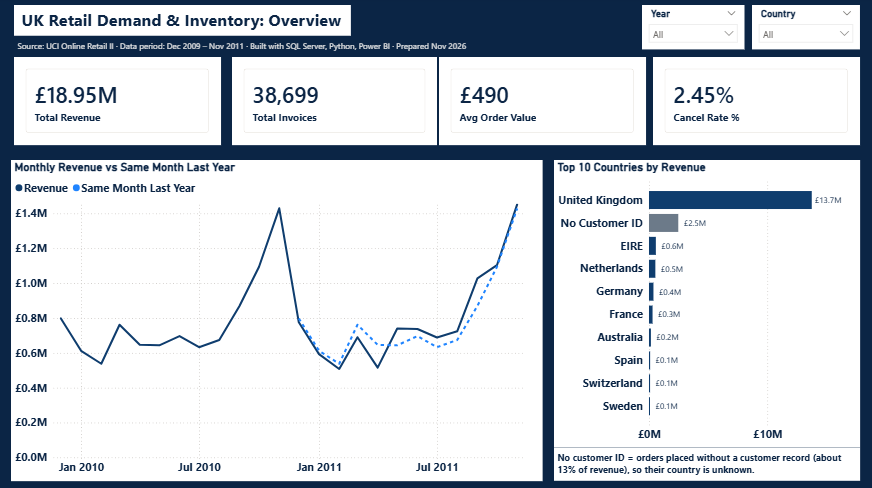
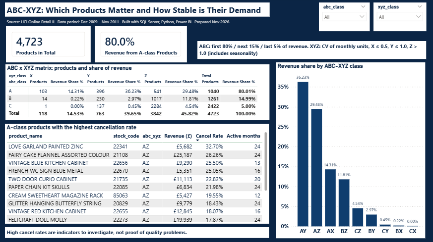
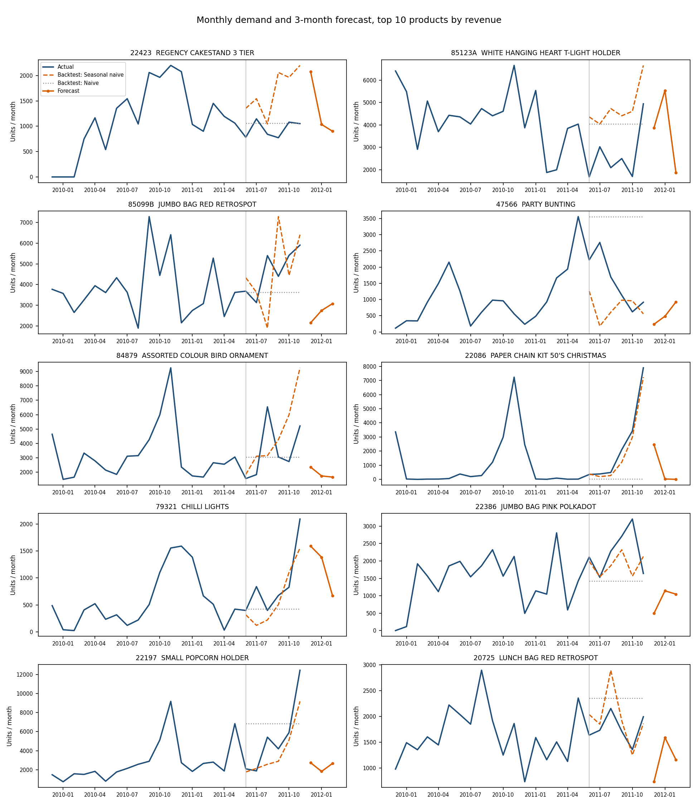
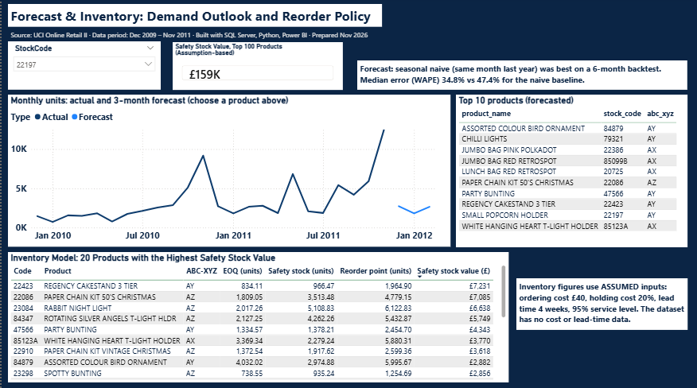

# Retail Demand and Inventory Analytics (SQL Server, Python, Excel, Power BI)

An end-to-end analysis of UK online retail sales: from cleaned transaction data to a SQL Server model, ABC-XYZ product classification, a demand forecast with a proper backtest, an inventory policy model in Excel, and a three-page Power BI dashboard.

Data: [Online Retail II](https://archive.ics.uci.edu/dataset/502/online+retail+ii) (UCI Machine Learning Repository), a UK-based online retailer. All values are in GBP. Analysis window: **24 complete months, December 2009 to November 2011** (December 2011 is incomplete and excluded).

This project builds on [Project 1: UK Online Retail Analysis](https://github.com/shirinaghaei/uk-online-retail-analysis), where the data was cleaned and analysed in Python.



## Business questions

1. Which products carry the revenue, and how stable is their demand?
2. How much revenue is lost to cancellations, and where?
3. Can demand be forecast better than a naive rule, and by how much?
4. What would reorder points and safety stock look like for the top products?

## Tools and what each was used for

| Tool | Use |
|---|---|
| **Python** (pandas, statsmodels, matplotlib) | Exporting the cleaned tables, demand forecasting, backtest |
| **SQL Server** (T-SQL) | Data model, reconciliation checks, views, ABC and XYZ classification, window functions (`LAG`, `RANK`, `SUM() OVER`) |
| **Excel** | Inventory model: EOQ, safety stock, reorder point, SUMIFS / COUNTIFS / INDEX-MATCH, assumption inputs |
| **Power BI** (DAX) | Three-page dashboard connected to SQL Server and Excel |

## Data model

The sales data is stored in tables named after the SAP SD billing structure (`VBRK` billing header, `VBRP` billing items, `KNA1` customers, `MAKT` material descriptions). This is a **structural mapping of public data to SAP-style tables, not data extracted from an SAP system.**

## Data quality and reconciliation

The tables were exported from Python and loaded into SQL Server with `BULK INSERT`. Control totals match in both systems:

| Check | Python | SQL Server |
|---|---|---|
| Sales line value | £19,411,634.42 | £19,411,634.42 |
| Invoices (VBRK) | 39,521 | 39,521 |
| Cancelled value | £471,062.77 | £471,062.77 |
| Lines in VBRP / customers / materials / cancellations | 1,003,605 / 5,853 / 4,724 / 17,919 | same |
| Invoices whose header total differs from the sum of their lines | | 0 |

Two issues found during the analysis:

- **Carriage (`C2`)** is a shipping charge, not a product (267 lines, £13,426). It had passed the first cleaning step and appeared as a top product for Ireland. It is excluded from the product analysis.
- **Orders without a customer ID** are 2,923 invoices worth £2,576,159, about **13% of revenue**. They stay in the totals but their country is unknown, so the dashboard shows them as "No customer ID" instead of dropping them.

## Key findings

All figures are for the 24-month window, excluding carriage.

**Revenue.** Total revenue was £18.95M across 38,699 invoices (average £490 per invoice). The second year (Dec 2010 to Nov 2011) was only about **1.7% higher** than the first (£9.56M vs £9.40M), so the business was roughly flat. Revenue is strongly seasonal: September to November is the peak (November 2010 £1.43M, November 2011 £1.45M), followed by a sharp fall in December and January.

**ABC analysis.** 1,040 of 4,723 products (22%) make 80% of revenue (class A). Class C is 51% of products and only 5% of revenue.

**XYZ analysis (demand variability).** Only 103 class-A products (AX) have stable demand, and they make 14.3% of revenue. Classes AY and AZ together make about 66% of revenue, so most of the revenue sits in products with variable demand. This is where safety stock matters.



**Cancellations.** The overall cancellation rate is 2.45% of revenue. Among class-A products sold in at least 12 of the 24 months, the highest rates are Love Garland Painted Zinc (32.7%), Fairy Cake Flannel Assorted Colour (26.3%) and Vintage Blue Kitchen Cabinet (25.5%). These are products to investigate, not proof of quality problems: a few large cancelled orders can drive a rate like this.

**Forecast.** Five simple models were compared on the last 6 months (June to November 2011) for the 10 highest-revenue products, trained on the first 18 months:

| Model | Median WAPE |
|---|---|
| Seasonal naive (same month last year) | **34.8%** |
| Moving average (3 months) | 43.0% |
| Holt, damped trend | 45.6% |
| Exponential smoothing | 46.9% |
| Naive (last month) | 47.4% |

Seasonal naive was best and beat the naive baseline for 6 of the 10 products. A full Holt-Winters model was not used because 24 months of data leave too little history to fit seasonality and also test it. Even the best model has a median error of about 35%, which supports holding safety stock for variable items instead of relying on a single forecast number.



**Inventory model (Excel).** For the 100 highest-revenue products the model calculates EOQ, safety stock and reorder point. With the assumptions below, safety stock for these 100 products is worth about £159K.



## Assumptions (inventory model)

The dataset has no cost, lead-time or ordering-cost data, so these inputs are **assumptions**, set in the `Assumptions` sheet and easy to change:

- Ordering cost: £40 per order
- Holding cost: 20% of unit cost per year
- Unit cost: 60% of selling price
- Lead time: 4 weeks
- Service level: 95%

## Limitations

- Only 24 months of data: seasonal patterns rest on two observations per month, and the XYZ classes include seasonality.
- The forecast backtest covers 6 months and 10 products. The model was chosen on the same test period, so the result is somewhat optimistic.
- The seasonal naive forecast repeats last year's pattern. It misses products whose pattern changed in the second year (for example Small Popcorn Holder in November 2011).
- Safety stock assumes roughly normal demand and uses the standard deviation of 24 months of demand, which includes seasonal peaks. For highly seasonal items it is conservative.
- Cancellation rates use all cancellations against sales in the 24-month window and can be inflated by single large orders.
- Cost, lead time and ordering cost are assumptions, not company data.

## Repository structure

```
sql/
  01_create_and_load.sql     Create database and tables, BULK INSERT, reconciliation checks
  02_analysis.sql            Views, ABC and XYZ tables, month-on-month change, country ranking, cancellations
  03_powerbi_views.sql       Small views used by Power BI
python/
  retail_demand_inventory_notebook.ipynb   Cleaning (Project 1), SQL export cell, forecasting cell
excel/
  Retail_Inventory_Model.xlsx   EOQ, safety stock, reorder point with assumption inputs
powerbi/
  Retail_Demand_Inventory.pbix  Three-page interactive dashboard (needs Power BI Desktop)
images/                          Dashboard screenshots and forecast chart
```

## How to reproduce

1. Download Online Retail II from UCI and run the cleaning and SAP-style model in the notebook (see Project 1).
2. Run the export cell at the end of the notebook. It writes five CSV files.
3. In SQL Server (SSMS), run `sql/01_create_and_load.sql`, then `sql/02_analysis.sql`, then `sql/03_powerbi_views.sql`. Adjust the `C:\retail_project\` path in the `BULK INSERT` statements to where you saved the CSV files.
4. Run the forecasting cell in the notebook.
5. Paste the top-100 product result from SQL into the `Data` sheet of the Excel model.
6. Open the `.pbix` in Power BI Desktop and update the data source settings to your SQL Server and Excel paths.

The interactive dashboard needs Power BI Desktop. The screenshots above show all three pages.

## Author

Shirin Aghaei. Background in supply chain operations; focus on supply chain analytics and procurement analytics.
